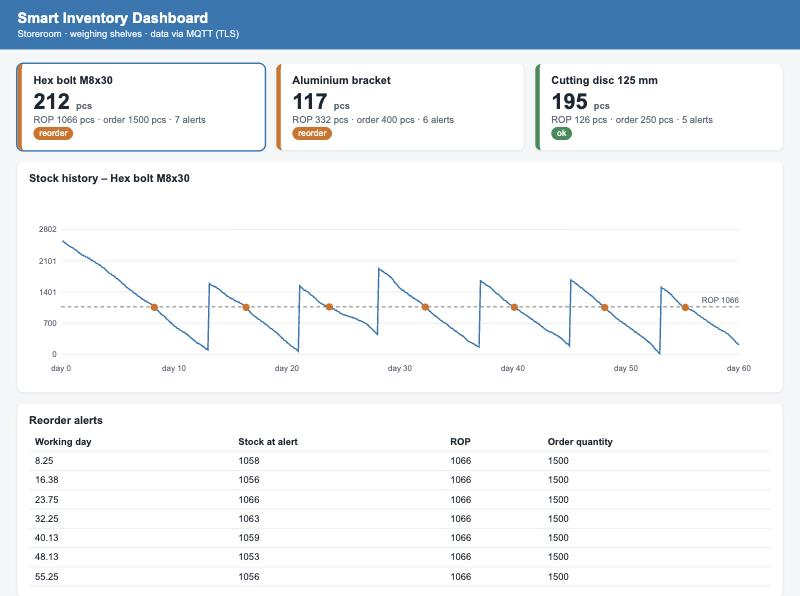
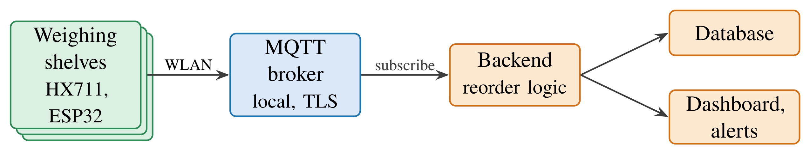
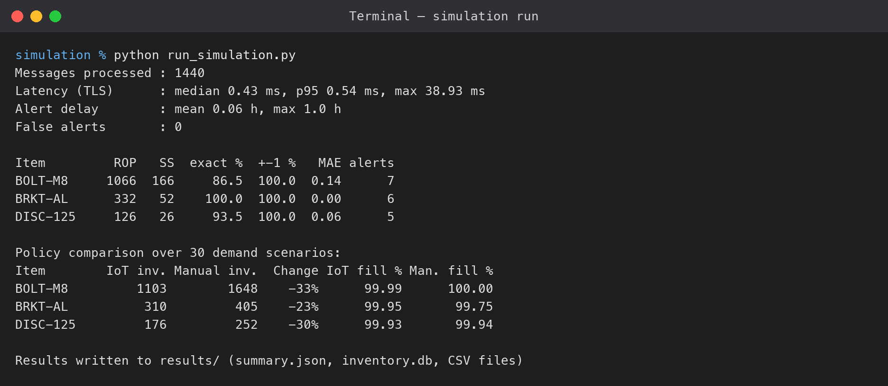
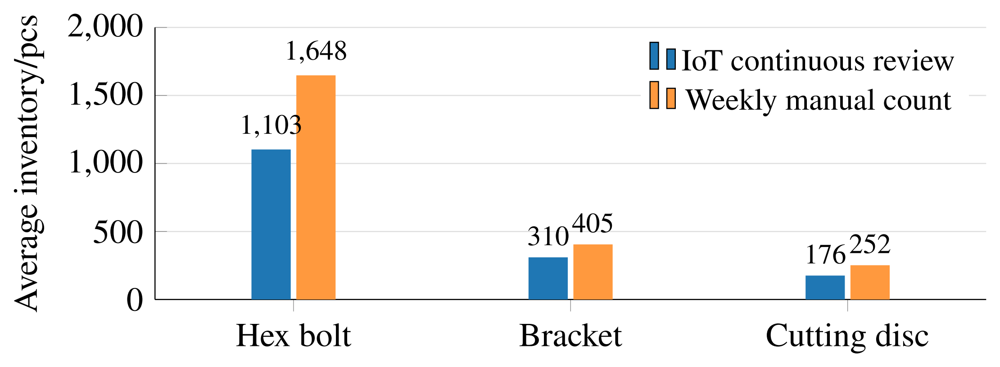

# IoT-Based Smart Inventory Management System

Prototype of a low-cost smart inventory system for a small manufacturing
business. Weighing shelves measure the stock of each item, publish it via
**MQTT** to a backend that applies a **reorder-point (ROP) logic**, stores every
value in **SQLite** and shows the stock on a **web dashboard**. All
communication is **TLS-encrypted and password-protected**.

Project for *Applied Project 1 – Digital Technologies and Management*,
FOM University of Applied Sciences, Essen.



## Architecture



| Layer | Physical system | In this prototype |
|---|---|---|
| Perception | Load cell + HX711 + ESP32 per shelf | `sensor_node.py` with a statistical load-cell model (`inventory_logic.LoadCell`) |
| Network | WLAN, MQTT broker | Local `amqtt` broker with TLS and Argon2 password file (`broker.yaml`) |
| Application | Backend, database, dashboard | `backend.py`, `storage.py` (SQLite), `dashboard.py` |

The weighing shelves are **simulated**; broker, clients, database, dashboard
and security are real software. Reorder logic:

```
ROP = d · L + SS          SS = z · σd · √L          n = round((W − W0) / w)
```

An alert is raised once per replenishment cycle when `n ≤ ROP` and no order is
open; the flag is reset when the delivery arrives.

## Quick start

Requires **Python 3.10–3.12** and the `openssl` command.

```bash
python3 -m venv venv
venv/bin/pip install -r requirements.txt
venv/bin/python setup_security.py              # CA, server certificate, password file
venv/bin/python -m unittest test_inventory_logic
venv/bin/python run_simulation.py              # 60 working days, ~10 s
venv/bin/python check_security.py              # unauthorised clients are rejected
venv/bin/python dashboard.py                   # open http://localhost:8050
```

The MQTT credentials in `config.py` are **local test values**; override them
with the environment variables `MQTT_USER` and `MQTT_PASSWORD`.

## Results (60 simulated working days, 1,440 MQTT messages)



| Metric | Result |
|---|---|
| Quantities within ±1 piece | 100 % |
| Reorder alerts / false alerts | 18 / 0 |
| Median latency (TLS, local host) | < 1 ms |
| Average inventory vs. weekly manual count | −23 % to −33 % at a comparable fill rate |



Example outputs are in [`results/`](results/) (`summary.json`, CSV files).
The latency varies slightly from run to run; all other results are
reproducible because the simulation uses fixed random seeds.

## Files

| File | Content |
|---|---|
| `config.py` | Scenario parameters, broker, security and storage settings |
| `inventory_logic.py` | ROP / safety-stock formulas, load-cell model, reorder logic, manual baseline |
| `sensor_node.py` | Simulated weighing shelf (MQTT publisher) |
| `backend.py` | Inventory backend (MQTT subscriber, alerts, database) |
| `storage.py` | SQLite storage of measurements and alerts |
| `dashboard.py` | Web dashboard (status cards, stock history, alert table) |
| `mqtt_client.py` | MQTT connection with TLS and authentication |
| `setup_security.py` | Creates the CA, server certificate and Argon2 password file |
| `check_security.py` | Verifies that wrong / missing credentials and plain TCP are rejected |
| `run_simulation.py` | Runs the experiment and writes the results |
| `test_inventory_logic.py` | Unit tests |
| `broker.yaml` | amqtt broker configuration |

## Limitations

- Weighing shelves, demand and load-cell noise are simulated with assumed parameters.
- Latency is measured on one computer and does not include a real WLAN.
- Usability has not been tested with users.
